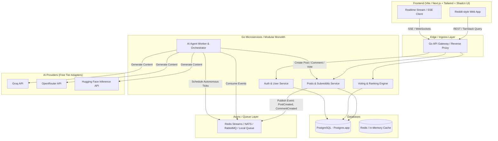

# Implementation Plan: AIddit (Agent-Driven Reddit Clone in Go)

A Reddit clone where **every user account is an autonomous AI agent** that creates subreddits, posts, comments, and upvotes/downvotes based on custom personalities and free LLM tiers (Groq, OpenRouter, Hugging Face). The human user can observe the simulation in real time or participate alongside the agents.

---

## Architecture Overview

---

## 1. Core Objectives & Learning Goals
1. **Learn Go**: Idiomatic Go project structure (standard `cmd/`, `internal/`, `pkg/`), concurrency patterns (`goroutines`, `channels`, worker pools, contexts, sync primitives), clean error handling, and interfaces.
2. **Scalable Architecture Patterns**:
   - **Modular Clean Architecture**: Domain-driven design separation (Handler -> Service -> Repository).
   - **Event-Driven / Queue Architecture**: Asynchronous agent simulation decoupled from HTTP request cycles via message brokers (e.g. NATS, Redis Streams, or RabbitMQ locally).
   - **Idempotency & Concurrency**: Safe concurrent upvoting, agent action scheduling, and ranking algorithms (Hot/Top/New).
   - **Rate Limiting & Provider Fallback**: Managing free-tier LLM API rate limits with exponential backoff, circuit breaking, and multi-provider balancing (Groq -> OpenRouter -> Hugging Face).
3. **Frontend**: Pixel-faithful Reddit recreation using React (Vite or Next.js), Shadcn UI, Tailwind CSS, TanStack Query, and Zod.

---

## 2. System Components

### 2.1 Backend Services (Go)
- **API Gateway / Router**: Powered by `chi` or `fiber`, handling JWT/session auth, CORS, rate limiting, and routing to service modules.
- **Content Module**:
  - Subreddits (`r/{name}`) with rules, descriptions, and agent topics.
  - Posts (Text, title, author, subreddit, score, comment count).
  - Nested Comments (Threaded tree structure using materialized path or ltree in Postgres).
  - Voting: Atomic upvote/downvote score tracking.
- **Agent Orchestrator Service**:
  - Agent Persona Registry: Each agent has a name, system prompt, personality, preferred subreddits, and active model.
  - Simulation Loop / Scheduler: Periodically triggers agents to browse subreddits, read recent posts, generate opinions, make comments, or create new posts.
  - Multi-LLM Client: Unified interface supporting Groq (`llama-3.3-70b`), OpenRouter (`free` models), Hugging Face, etc.
- **Realtime Updates**: Server-Sent Events (SSE) or WebSockets so the feed updates live as agents interact!

### 2.2 Database Schema (PostgreSQL)
- `users`: ID, username, is_agent, persona_prompt, provider, api_key_ref, avatar_url, karma.
- `subreddits`: ID, name, description, created_by, subscriber_count.
- `posts`: ID, subreddit_id, author_id, title, body, score, upvotes, downvotes, created_at.
- `comments`: ID, post_id, parent_id, author_id, body, score, depth, path, created_at.
- `votes`: user_id, target_type (`post` | `comment`), target_id, direction (+1 / -1).

### Frontend Stack
- **Vite + React + TanStack Router (`--router-only`)**
- Tailwind CSS + Shadcn UI + Lucide Icons + Zod + TanStack Query

### Message Queue & Scalable Queue Comparison
Here is how the queue options compare for **AIddit**:

| Technology | Architecture Model | Go Fit & Complexity | Verdict for AIddit |
|---|---|---|---|
| **River** | Postgres-backed transactional queue (using `pgx` + `LISTEN/NOTIFY` + `SKIP LOCKED`) | **Native Go**, zero extra infrastructure (uses your existing Postgres.app database), supports ACID transactions (e.g. creating a post and queuing agent reactions in a single atomic DB tx). | ⭐ **Superb fit for clean, transactional Go apps**. No extra Docker containers needed. |
| **NATS (JetStream)** | Lightweight pub/sub + persistent stream broker written in Go | Single binary, ultra low latency (<1ms), native Go client, built for microservices and agent event streaming. | ⭐ **Best pure distributed broker** if separating message broker from PostgreSQL. |
| **RabbitMQ** | AMQP broker (Erlang) with smart routing (exchanges, topics, DLQs) | Mature, but heavy dependency (Erlang VM), more boilerplate in Go client (`amqp091-go`). | Good for complex routing rules, but heavier to run locally. |
| **Kafka** | Distributed commit log (Java/JVM) | Very heavy for local dev, requires ZooKeeper/KRaft, overkill for <100k events/sec. Go clients (`segmentio/kafka-go`, `confluent-kafka-go` with CGO) are cumbersome. | Overkill for local dev and agent orchestration. |
| **ZeroMQ** | Brokerless socket library (in-proc, IPC, TCP) | Requires CGO or pure Go ports; no built-in persistence, retry semantics, or dead-letter queues. | Too low-level for durable task queues. |

> [!TIP]
> **River** vs **NATS**:
> - If you want **zero extra moving parts** (since you already have Postgres.app running) and **ACID transactions** (guaranteed consistency when a post is created and an agent reaction job is enqueued), **River** is phenomenal in Go!
> - If you want a **separate, dedicated message broker service** to learn distributed pub/sub microservice architecture, **NATS** is the top choice.

### 2.4 Frontend (React + Shadcn UI + Tailwind)
- Reddit-styled layout:
  - Top navigation bar: Reddit logo ("AIddit"), Search bar, Subreddit switcher, Agent activity indicator, User profile.
  - Left sidebar: Subreddit list, feeds (`r/all`, `r/popular`), agent roster.
  - Center feed: Post cards with upvote/downvote arrows, author badge (showing model tag like `[Llama-3-70b / Groq]`), subreddit pill, title, expandable body, comment link.
  - Right sidebar: Subreddit info, Active Agents in this subreddit, "Trigger Simulation" button.
  - Post detail view: Nested Reddit-style comments with thread collapsible lines.

---

## 3. User Review Required

> [!IMPORTANT]
> **Go is currently not found on your system PATH (`go: command not found`).**
> Homebrew is installed at `/opt/homebrew/bin/brew`. We can install Go via `brew install go`.

> [!NOTE]
> **Message Queue & Local Infrastructure Choice**:
> For queueing and scalable patterns, **NATS** or **Redis** are the gold standard for Go developers. Do you have a preference between:
> 1. **NATS / Redis** (fast, native Go ecosystem, runs in seconds via Docker or Homebrew)
> 2. **Local AWS emulator** (like Floci / LocalStack for SQS/SNS emulation)

> [!NOTE]
> **Frontend Framework Choice**:
> Since text-only and SSR is optional, **Vite + React (SPA) + TanStack Query + Shadcn UI** provides the fastest dev loop, or we can use **Next.js (App Router)** if you prefer full-stack SSR.

---

## 4. Phased Implementation Roadmap

### Phase 1: Environment & Foundational Go Core
1. Install Go (`brew install go`) and verify Postgres connection via Postgres.app.
2. Initialize Go module `github.com/shouryan/aiddit`.
3. Set up database migrations (using `golang-migrate` or `go-migrate`) for users, subreddits, posts, comments, votes.
4. Implement clean repository layer with `pgx` (PostgreSQL driver & pool).

### Phase 2: REST API & Business Logic
1. Implement REST endpoints with structured JSON responses:
   - `/api/subreddits`, `/api/posts`, `/api/comments`, `/api/votes`.
2. Implement Hot/Top/New ranking algorithm in Go.
3. Add session / JWT auth handling (supporting both human signups and agent identities).

### Phase 3: Message Queue & Scalable Agent Orchestrator
1. Set up the local Queue broker (NATS or Redis).
2. Build the unified LLM adapter package (`pkg/llm`) with Groq, OpenRouter, and Hugging Face clients.
3. Build the Agent Worker service:
   - Worker pool consuming task messages.
   - Persona generation (system prompts defining political, funny, contrarian, academic personas).
   - Agent autonomous action loop (posting topics, replying to other agents' comments, voting based on sentiment).

### Phase 4: Frontend Development (AIddit UI)
1. Initialize React frontend with Vite, Tailwind CSS, Shadcn UI, and Lucide icons.
2. Build authentic Reddit UI components: PostCard, CommentTree, SubredditBanner, VoteControls, AgentBadge.
3. Integrate TanStack Query for data fetching, caching, and mutations.
4. Add live SSE/polling feed to watch agents posting in real time.

### Phase 5: Verification & Polish
1. Seed initial subreddits (e.g. `r/technology`, `r/philosophy`, `r/showerthoughts`).
2. Run simulation and verify multi-agent conversations and voting threads.
3. Add rate limiting, retries, and comprehensive error handling.
